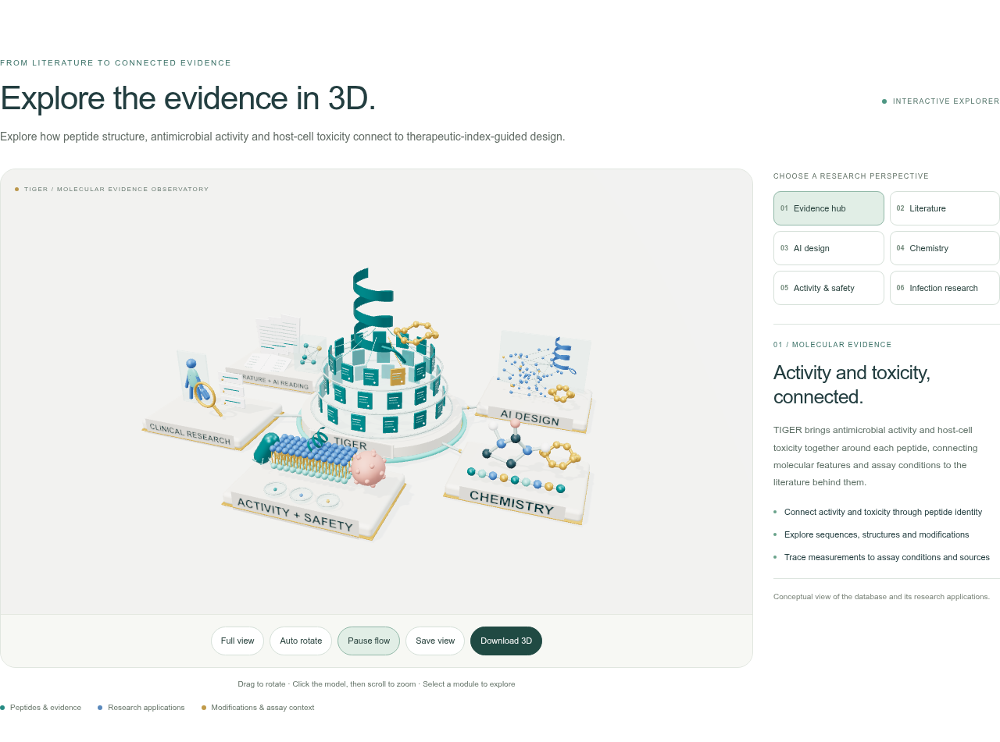

# TIGER AMP Database

**Therapeutic-Index-Guided Exploration and Refinement**

**连接抗菌活性与宿主细胞毒性，支持高治疗指数抗菌肽设计。**

[English](README.md) · 中文介绍

TIGER 是通过 AI Agents 对原始研究论文及补充材料开展语义阅读和结构化信息提取建立的抗菌肽数据库。它以文献中的肽实体为纽带，连接抗微生物活性、宿主细胞毒性、分子结构与实验条件，为抗菌肽的活性、选择性和分子设计研究提供可追溯的数据基础。

**[访问 TIGER](https://yuewang-lambda.github.io/tiger-amp-database/)** · [检索多肽](https://yuewang-lambda.github.io/tiger-amp-database/search/) · [下载数据](https://yuewang-lambda.github.io/tiger-amp-database/download/) · [数据指南](https://yuewang-lambda.github.io/tiger-amp-database/help/)

## TIGER 关注什么？

抗菌肽设计需要同时考虑对微生物的效力和对宿主细胞的影响。TIGER 将两类证据连接到同一肽实体，并保留浓度单位、实验终点、培养基和测量条件，支持研究者结合实验背景分析肽的选择性。

- **关联活性与毒性：** 查询肽—菌株、肽—宿主细胞关系，以及同一肽的两侧实验证据。
- **理解实验背景：** 查看原始测量、删失界、培养条件和图源标记。
- **探索肽的化学信息：** 浏览序列、末端、修饰、分子注释、结构示意图及文献提供的 SMILES。
- **支持计算研究：** 下载按条件分类的简化表和保留源条件的核心表；导出筛选结果 CSV 与原文序列 FASTA。
- **回溯原始证据：** 从肽实体追踪测量、文献和聚合来源。

## 当前数据规模

**源数据发布日期：2026-10-25；公开数据包日期：2026-11-03；比较审计修订：2026-11-06；序列与定量配对快照：2026-11-04。**

| 数据层级 | 数量 |
| --- | ---: |
| 文献特异的肽实体档案 | 50,992 |
| 序列字段非缺失的实体 | 40,986 |
| 双单位核心表实体并集 | 37,800 |
| 来源文献引用条目 | 7,610 |
| 与档案实体关联的原始 measurements 行 | 346,095 |
| 与档案实体关联的原始 safety 行 | 36,218 |
| 肽—菌株活性关系 | 142,265 |
| 肽—宿主毒性关系 | 4,530 |
| 肽 × 菌株 × 宿主关联证据 | 19,888 |

实体数量按文献特异的 ID 计数，相同序列在不同实体 ID 下保留各自来源。序列字段保留修饰和未解析残基等原始表示。

原始长表行数保留终点、靶标、单位、数值筛选和聚合之前的来源记录，其中普通 MIC 标签对应 262,477 行。[审计后的比较页面](https://yuewang-lambda.github.io/tiger-amp-database/statistics/#source-record-coverage)分别展示原始长表记录、条目注释覆盖、统一规则的浓度证据签名及来源文献覆盖，明确各数字的计数对象。

活性关系包括 **136,237 对细菌菌株关系**和 **6,028 对真菌菌株关系**。**3,023 个核心实体**提供了上述 19,888 条活性—毒性关联证据；每条关联连接一个肽、一种菌株和一个细胞系或红细胞来源。选择性分析可据此选择实验终点、统一单位并评估条件可比性。[查看详细计数规则](https://yuewang-lambda.github.io/tiger-amp-database/help/#experimental-relations)。

## 从文献到可分析的数据

1. 语义阅读原始文献及补充材料，提取肽身份、序列、化学注释、实验测量与来源。
2. 建立完整实体档案，连接分子描述和实验记录。
3. 按终点、微生物或宿主、浓度语义、数值及单位规则选择核心浓度证据，以 µg/mL 和 µM 两表成员并集定义核心实体。
4. 解析菌株和宿主身份，关联同一肽的活性与毒性，并在明确的条件类别内汇总 MIC。

[完整档案](https://yuewang-lambda.github.io/tiger-amp-database/archive/)还包括核心集合之外的 13,192 个实体，可继续查看其分子描述和来源记录。

## 检索和下载

网站提供[多肽检索](https://yuewang-lambda.github.io/tiger-amp-database/search/)、[关联证据](https://yuewang-lambda.github.io/tiger-amp-database/relations/?kind=paired)、[文献索引](https://yuewang-lambda.github.io/tiger-amp-database/publications/)、[统计](https://yuewang-lambda.github.io/tiger-amp-database/statistics/)和[数据指南](https://yuewang-lambda.github.io/tiger-amp-database/help/)。浏览、检索和下载均无需注册。可从 [melittin](https://yuewang-lambda.github.io/tiger-amp-database/search/?query=melittin) 或示例肽 [AS0170-P2](https://yuewang-lambda.github.io/tiger-amp-database/peptide/?id=AS0170-P2) 开始探索。

统计页面还提供与 DRAMP 5.0、DBAASP v4 和 dbAMP 3.0 的序列覆盖比较、活性—毒性证据口径说明，以及可下载的比较数值和图表。可分别查看 TIGER 完整档案、核心集和关联证据子集的序列交集。

[下载页面](https://yuewang-lambda.github.io/tiger-amp-database/download/)提供四张主要 CSV.gz 表格：

| 表格 | 单位 | 行数 | 每行含义 |
| --- | --- | ---: | --- |
| 肽 × 条件类别简化表 | µg/mL | 36,419 | 一个肽实体及一个 MIC 条件类别 |
| 肽 × 条件类别简化表 | µM | 39,803 | 一个肽实体及一个 MIC 条件类别 |
| 源条件核心宽表 | µg/mL | 34,533 | 一个肽实体，不同源条件保留在不同列 |
| 源条件核心宽表 | µM | 37,800 | 一个肽实体，不同源条件保留在不同列 |

模型数据整理可从简化表开始：MIC 按 20 个固定条件类别组织，同一肽可有多行；肽级毒性值会在其条件行间重复。划分训练、验证和测试集时，将相同 `split_group_id` 放入同一分区，并结合关联的资格标记、行状态和研究目标选择数据。[查看条件分类与训练规则](https://yuewang-lambda.github.io/tiger-amp-database/help/#condition-classes)。

分析时保留缺失状态及 `>128`、`>=64`、`<0.5` 等浓度界限。公开 SMILES 字段使用原文献提供的值。单位覆盖、序列完整性和结构图含义见数据指南。

[GitHub Releases](https://github.com/YueWang-Lambda/tiger-amp-database/releases)保存固定版本部署归档和校验清单；数据分析通常从网站提供的四张主要表格开始。

## 引用与联系

使用数据时，请注明 **TIGER AMP Database（Therapeutic-Index-Guided Exploration and Refinement）**、网站地址与数据版本；涉及具体实体和实验结果时，注明肽 ID 并引用对应原始文献。

- 开发人员：[YueWang-Lambda](https://github.com/YueWang-Lambda)
- 实验室：[宾夕法尼亚大学 de la Fuente Lab](https://delafuentelab.engineering.upenn.edu/)
- 纠错与反馈：[GitHub Issues](https://github.com/YueWang-Lambda/tiger-amp-database/issues)。数据问题请附肽 ID、来源文献、版本和相关字段或页面。

本仓库保存公开网站源代码。网站由 GitHub Pages 托管，检索、筛选与结果导出在浏览器运行。本地构建、部署、更新及恢复步骤见[维护文档](docs/MAINTENANCE.md)。
